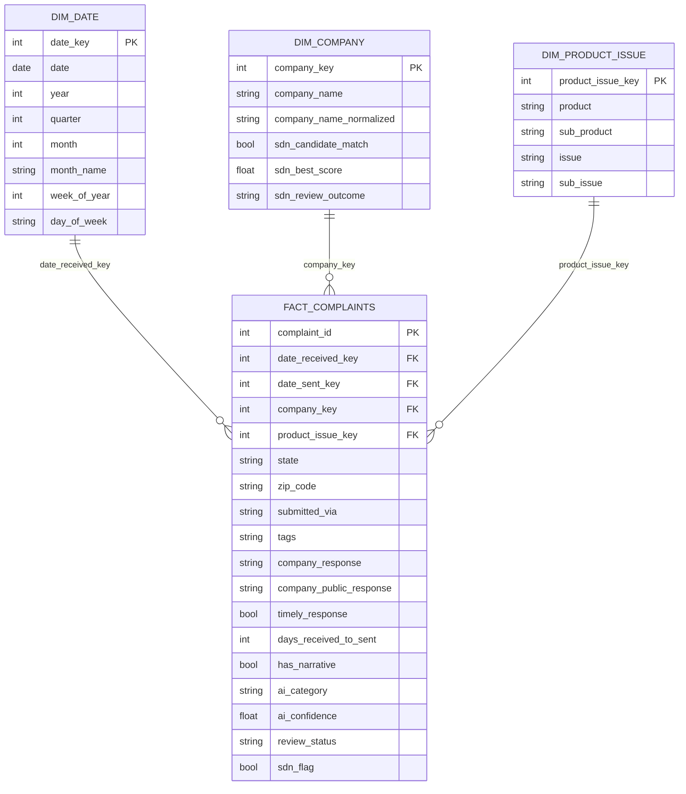

# Star schema (v0 sketch)

Grain of the fact table: one row per CFPB complaint (`complaint_id`).

## Column notes

| Table | Column | Source |
|---|---|---|
| fact | complaint_id, state, zip_code, submitted_via, tags, company_response, company_public_response, timely_response | CFPB CSV columns as published |
| fact | date_received_key / date_sent_key | CFPB `Date received` / `Date sent to company` → `dim_date` |
| fact | days_received_to_sent | derived. CFPB does not publish the company's actual response date, so response-time checks rely on the `Timely response?` flag |
| fact | has_narrative | derived. The narrative text is not in the default CSV export; it needs the `complaint_what_happened` field (TODO) |
| fact | ai_category, ai_confidence, review_status | AI summary/classification layer (TODO, not built yet) |
| fact / dim_company | sdn_flag, sdn_candidate_match, sdn_best_score, sdn_review_outcome | fuzzy match against OFAC SDN plus human review (TODO). A candidate match is **not** a sanctions hit until it has been reviewed |
| dim_product_issue | product … sub_issue | CFPB columns, deduplicated |
